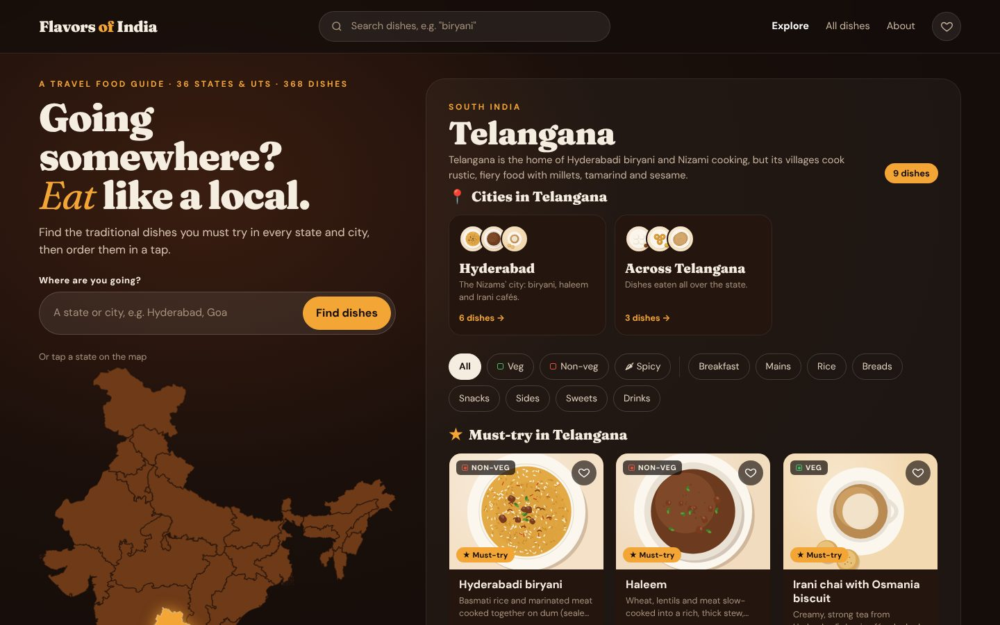
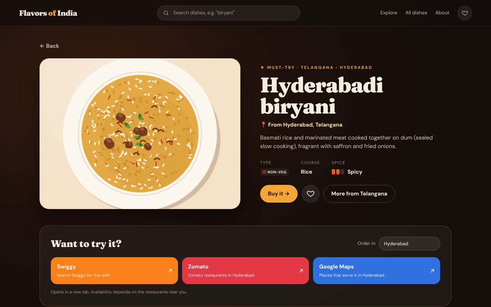
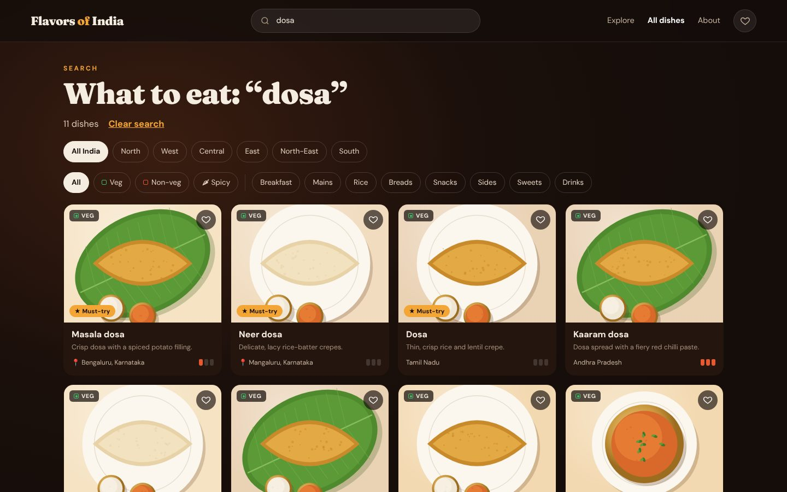
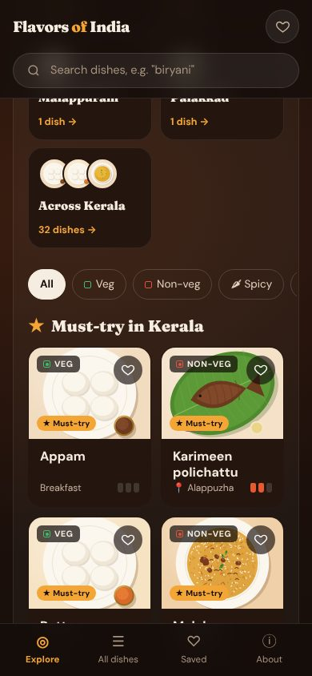

# Flavors of India 🍛

**Going somewhere? Eat like a local.** A travel food guide to India: tell it where you're going (a state, or a town like Tirupati or Madurai) and it shows the traditional dishes you must try there, the story behind each one, and a quick way to order it on Swiggy or Zomato or find it on Google Maps.

**Why:** when you travel in India, it's hard to know which local dishes are worth trying. Search engines give scattered lists. This puts everything in one place.

**Live:** _add your Vercel link here_ · **Built by** [Pratibha Jallu](https://pratibhajallu.vercel.app)



## Features

- **Every state and union territory, split into cities.** India → state → city → that city's special dishes (e.g. Telangana → Hyderabad → biryani, haleem, Irani chai), plus "Across the state" for dishes eaten everywhere.
- **"Where are you going?"** Type a state or a city (Hyderabad, Tirupati, Jaipur, Kolkata…) with suggestions as you type, and jump straight to its dishes.
- **Must-try dishes** for every state, each with the story of where it comes from and why it matters.
- **Buy it:** every dish links to Swiggy, Zomato and Google Maps, already searching for that dish in your city (remembered for next time). A dish can also have a hand-picked recommended restaurant.
- **Interactive map of India.** States with dishes glow; click or use the keyboard (Tab + Enter) to explore one.
- **368 dishes across 36 states and UTs**, each with diet, course, spice level, city and its own **original illustration, drawn in code** (no stock or copyrighted photos).
- **Search** across every dish, forgiving of spelling variations (`biriyani` finds `biryani`, `idly` finds `idli`).
- **Filters** for veg / non-veg, spicy, and 8 courses. Filters live in the URL, so any view can be shared.
- **Dish pages** with details and "More from this state".
- **Favourites** saved on your device (no account needed), synced across open tabs.
- **Responsive**: works from small phones (with an app-style tab bar) to large monitors.
- **Accessible**: keyboard-friendly map, screen-reader labels, visible focus and reduced-motion support.

| Dish page | A city: Hyderabad | Phone |
|---|---|---|
|  |  |  |

## Tech stack

| Part | Tools |
|---|---|
| Front end | React 18, React Router 6, Vite, plain CSS |
| Back end | Node.js, Express (REST API) |
| Tests | Node's built-in test runner (`node --test`) |
| Hosting | Vercel: static site + serverless API |

## API

| Method | Endpoint | What it returns |
|---|---|---|
| GET | `/api/states` | All states and UTs with their cities, counts and intros |
| GET | `/api/places` | States and cities people can search for |
| GET | `/api/dishes` | Dishes, filtered by `q`, `state`, `city` (`none` = across the state), `region`, `diet` (`veg`/`nonveg`), `course`, `minSpice`, `ids`, `limit` |
| GET | `/api/dishes/:id` | One dish plus 4 related dishes from the same state |
| GET | `/api/states/:id` | One state and its dishes |

Example: `/api/dishes?state=tg&city=hyderabad&diet=veg`

Invalid filters return `400` with a helpful message; unknown ids return `404`.

## Add a recommended place for a dish

Open `data/dishes.json`, find the dish, and fill in `orderLinks`:

```json
"orderLinks": [
  { "label": "Annachis Kuzhambu Kadai · Zomato", "url": "https://www.zomato.com/..." }
]
```

It appears first in the dish's "Want to try it?" box.

## Dish illustrations

Every dish image is drawn in code: `scripts/art/specs.py` picks how a dish is served (curry bowl, rice, dosa on a leaf, laddus, a thali...) and its colours from the dish's name and course, and `scripts/art/illustrate.py` draws it as an SVG. After adding dishes, redraw them all with:

```
python3 scripts/art/generate.py
```

To use your own photo instead, put it in `public/images/<state id>/` and set the dish's `"image"` in `data/dishes.json`. Only use photos you took or have the right to use.

## Project structure

```
api/index.js        Vercel entry: hands /api/* requests to the Express app
server/app.js       Express routes
server/dishes.js    Search, filter and lookup logic (pure functions)
server/*.test.js    API logic tests
data/dishes.json    States and dishes
src/                React app (pages, components, hooks)
public/images/      Dish illustrations (SVG), generated by scripts/art
scripts/art/        The Python illustrator that draws every dish
```

## Run it locally

```bash
npm install
npm run dev      # API on :3001 + website on :5173
npm test         # run the tests
npm run build    # production build into dist/
```

## Engineering notes

- **Performance:** all 368 dish images are small code-drawn SVGs (about 10 KB each), loaded lazily, and API responses are cached in memory on the client and at the edge.
- **Search ranking:** a state name shows its must-try dishes first; a town shows dishes from that town first ("tirupati" → Tirupati laddu); otherwise whole-word name matches come first ("dosa" → Masala dosa).
- **Ordering links:** Swiggy and Zomato have no public search APIs, so the app builds search links with the dish and city filled in.
- **Separation:** search and filter logic is pure and tested on its own, so Express only handles HTTP.

## Credits

- Map outlines: [@svg-maps/india](https://github.com/VictorCazanave/svg-maps) by Victor Cazanave, CC BY 4.0.
- Every dish illustration is original, drawn by `scripts/art` for this project.
